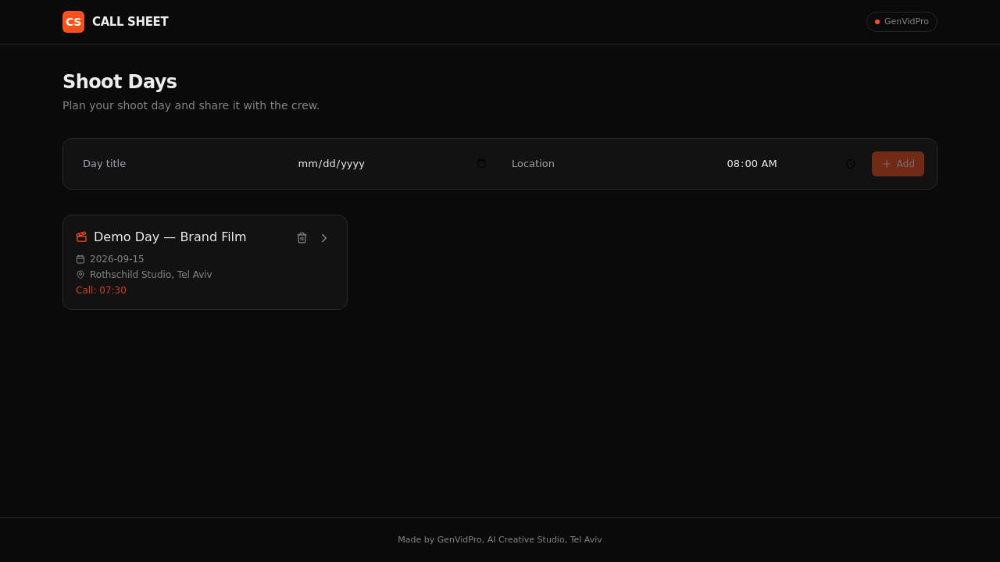

# CALL SHEET

**A production planning tool for video crews — shoot days, running schedule, crew list and shot list in one printable page.**

🔗 **Live demo:** https://brilliant-plan-shot-flow.base44.app

## What it does

A shoot day has a call time, a running order, a crew with individual call times, and a shot list. CALL SHEET keeps all four in one place and turns them into the single A4 sheet the crew actually gets handed on set.

Create a shoot day, fill the four tabs, hit **Print**. Times recalculate themselves as blocks move, so a 20-minute overrun in the morning rolls through the whole day instead of being retyped.

## Features

- **Shoot days** — title, date, location, general call time; everything editable in place.
- **Schedule** — drag-to-reorder blocks; start and end times recompute from the call time and each block's duration, with the wrap time shown at the bottom.
- **Crew** — name, role, phone, per-person call time. Tap a number to dial it, or copy the whole list pre-formatted for WhatsApp.
- **Shots** — size, camera move, lens, note, done/not done, with a progress bar over the day.
- **Sheet** — a clean one-page A4 call sheet, print stylesheet included.

## Stack

Built on **Base44**: React + Vite frontend, Base44 entities (`ShootDay`, `ScheduleItem`, `CrewMember`, `Shot`) for data, Base44 auth, hosted on Base44. UI is Tailwind CSS with shadcn/ui primitives; drag and drop via `@hello-pangea/dnd`.

## How this is built

Idea, product decisions and creative direction by Roma Chorny (GenVidPro). Built on Base44 with Claude.

## Notes on this repository

- This is the app's source as exported from the Base44 platform API. Local setup and publishing instructions are in [`README.base44.md`](README.base44.md).
- `src/components/ui/` holds only the shadcn/ui primitives this app actually imports — Base44 scaffolds the full set into every app, and the unused ones are left out to keep the repo readable.
